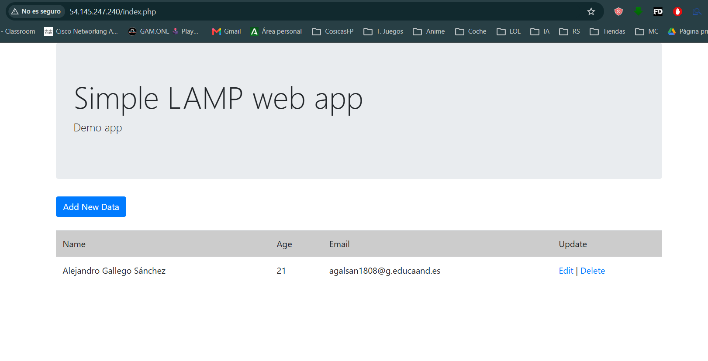
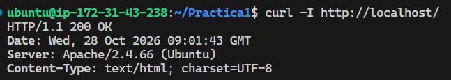

# Práctica 1.2 - Despliegue de una aplicación web LAMP

Alejandro Gallego Sánchez  
2.º DAW

## 1. Introducción

En esta práctica he desplegado una aplicación web conectada a una base de datos MySQL utilizando una instancia de Ubuntu Server en AWS Academy.

He aprovechado el servidor LAMP configurado en la práctica 1.1 y he utilizado un script de Bash para automatizar parte del despliegue.

## 2. Descarga de la aplicación

He utilizado la aplicación propuesta en el enunciado de la práctica.

Repositorio original: https://github.com/josejuansanchez/iaw-practica-lamp

He clonado el repositorio y he copiado los archivos de la aplicación al directorio `/var/www/html/`, que utiliza Apache para servir las páginas web.

## 3. Configuración de la base de datos

He creado una base de datos llamada `lamp_db` en MySQL y una tabla llamada `users`, que contiene los siguientes campos:

- `id`: identificador del usuario.
- `name`: nombre del usuario.
- `age`: edad del usuario.
- `email`: correo electrónico.

Después he configurado el archivo `config.php` con los datos necesarios para conectar la aplicación a la base de datos.

## 4. Comprobación de la aplicación

Una vez copiados los archivos y configurada la conexión con MySQL, he accedido a la aplicación desde el navegador.

La aplicación permite consultar, añadir, editar y eliminar usuarios.

## 5. Automatización del despliegue

Para automatizar el despliegue he creado el script `scripts/deploy.sh`, que realiza las siguientes tareas:

1. Descarga el repositorio de la aplicación si todavía no existe.
2. Comprueba que existe el directorio `src`.
3. Copia los archivos a `/var/www/html/` sin sobrescribir `config.php`.
4. Configura los permisos de los archivos.
5. Comprueba la configuración de Apache.
6. Reinicia Apache.

Antes de ejecutar el script, he comprobado su sintaxis mediante el comando:

`bash -n scripts/deploy.sh`

## 6. Prueba final

Después de ejecutar el script, he comprobado que Apache respondía correctamente mediante el siguiente comando:

`curl -I http://localhost/`

La respuesta obtenida fue `HTTP/1.1 200 OK`, confirmando que el servidor respondía correctamente.

## 7. Archivos del proyecto

- `scripts/install_lamp.sh`: script de instalación de LAMP.
- `scripts/deploy.sh`: script de despliegue de la aplicación.
- `scripts/.env.example`: ejemplo de variables de configuración.
- `conf/000-default.conf`: configuración de Apache.
- `php/index.php`: archivo PHP utilizado para comprobar el servidor.
- `capturas/`: capturas del funcionamiento de la aplicación.
- `.gitignore`: evita subir archivos con información privada.

## 8. Conclusión

Con esta práctica he aprendido a desplegar una aplicación web conectada a MySQL, automatizar parte del despliegue mediante Bash y comprobar su funcionamiento desde el navegador y la terminal.

También he utilizado Git y GitHub para organizar y documentar el trabajo realizado.
